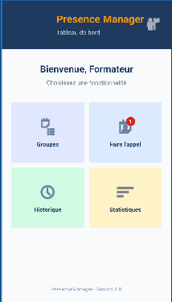

# PresenceManager

Application Android développée dans le cadre du module **M203 — Développer des interfaces utilisateurs sous Android** (Filière : Développement Digital — Option Applications Mobiles).

## 📱 TP01 — Interface d'accueil
Lors du premier TP, nous avons réalisé l'interface d'accueil de l'application. 
- Création du projet Android (Kotlin & XML).
- Utilisation des layouts de base (ConstraintLayout).
- Mise en page des composants d'authentification/d'accueil.

## 📊 TP02 — Tableau de bord (Dashboard)
Le deuxième TP consistait à créer l'interface du tableau de bord pour les formateurs (`DashboardActivity`).
- **Layouts utilisés** : `ConstraintLayout` (conteneur principal), `RelativeLayout` (en-tête), `LinearLayout` (textes et cartes), `GridLayout` (grille de 2x2 pour les fonctionnalités), `FrameLayout` (superposition du badge rouge).
- **Composants** : En-tête avec titre et profil, message de bienvenue, grille de 4 fonctionnalités (Groupes, Faire l'appel, Historique, Statistiques), et pied de page.
- Ajout d'un badge de notification (CardView) sur l'icône "Faire l'appel".

### 📸 Capture d'écran du Tableau de bord (TP02)
*(Assurez-vous d'avoir uploadé l'image dans le dépôt avec le nom `dashboard_screenshot.png` ou modifiez le nom ci-dessous selon votre fichier)*

---
*Dépôt GitHub mis à jour avec les réalisations des TP01 et TP02.*
