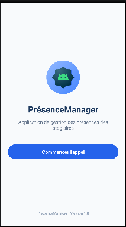

# PresenceManager

Android application for managing trainee attendance (PrésenceManager). 
**TP01 — Home screen interface (M203).**

## Description
Application de gestion des présences des stagiaires. This project builds the home screen (`MainActivity`) with a logo, title, description, a "Commencer l'appel" button, and a footer.

## Screenshot

## Author
[Your Name]
